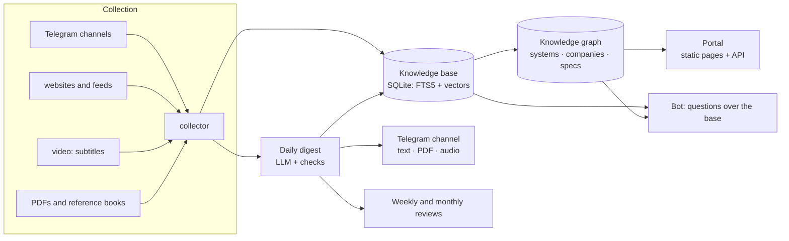

**English** | [Русский](README.md)

# Military technology analytics from open sources

**Asymmetria** ([asymmetria.tech](https://asymmetria.tech)) is an analytical product about military hardware and technology: a daily digest in Telegram, a knowledge base, a graph of systems and manufacturers, a web portal with analytical tools, and a bot that answers questions from the knowledge base. Everything is built from open sources, and every statement links to its primary source.

This repository is a **case study**: how the product works and how one person built it together with AI agents in four months. The product code itself is private. What you will find here is the architecture, the key decisions, the working methods, and a few cleaned-up general-purpose modules.

**Author:** Paul Makarevich · [paulmakarevichart@gmail.com](mailto:paulmakarevichart@gmail.com) · Telegram [@Paulmakarevichart](https://t.me/Paulmakarevichart)

---

## What the product does

- **Every morning**, a digest: what is new in drones, counter-drone systems, air defence, electronic warfare, communications, military space and AI. Hundreds of posts a day are reduced to what matters, fact-checked before publication, and shipped as text, a PDF with photos of the hardware, and an audio version.
- **Every week and every month**, trend reviews with forward projections: where a trend is heading and which observable sign will confirm or refute it. The monthly issue scores past forecasts against what actually happened.
- **Knowledge base**: posts, articles, reference books and PDFs with full-text and vector search.
- **Knowledge graph**: systems, manufacturers, components, technologies; every specification shows how many independent sources support it.
- **Portal**: system cards, a technology map, a maturity curve, production geography, open industry reviews with interactive 3D diagrams.
- **Bot**: questions answered from the knowledge base with source links, per-system dossiers, subscription payments.

## Scale (November 2026)

| | |
|---|---|
| Telegram posts in the knowledge base | 157k from 124 channels |
| External articles and reference-book fragments | 18k |
| Daily digests | 149 in a row since July 2026 |
| Knowledge graph | 10.6k entities · 60.8k specifications · 21k relations |
| Code | ~135k lines of Python · 79 modules · ~150 tests · 985 commits in 4 months |

## Architecture at a glance

Details: [docs/en/architecture.md](docs/en/architecture.md).

## Stack

Python · Telethon · SQLite (FTS5 + sqlite-vec) · Voyage embeddings · Claude models (Opus, Sonnet, Haiku, Fable) with Gemini on Google Cloud as a fallback · WeasyPrint · D3 and three.js · nginx · systemd and cron on a Google Cloud VM · Telegram Bot API · Google speech synthesis.

## How it was built

The product was written by one person together with AI agents (Claude Code). The main lesson was not "ask a model to write code" but **build a system in which agents can be trusted with real work**:

- **An OS sandbox around every agent command** and a separate user for production: the agent physically cannot see the keys and cannot deploy code on its own.
- **Deployment is a button in the bot**, behind gates: an import check of every module, an access-control test, and a green "lab" run for any change to the digest path.
- **The digest lab**: a full run of a real day without publishing, with its own daily spending cap. A change is verified on real data, not on a hunch.
- **A lessons log**: every incident records what broke, why, and what follows. The rule ends up in code or a test, not in a note.
- **Money under control**: the cost of every model call is recorded, spending kill-switches exist, and models are chosen by measuring them on our own tasks.
- **Testing AI on the archive**: forecasts from different models are built retrospectively and scored by a blind judge against what actually happened.

Details: [docs/en/ai-agents.md](docs/en/ai-agents.md); decisions: [docs/en/decisions.md](docs/en/decisions.md); lessons: [docs/en/lessons.md](docs/en/lessons.md).

## What is in this repository

| Folder | Contents |
|---|---|
| [docs/en/](docs/en/) | architecture, working with AI agents, decisions, lessons (Russian originals in [docs/](docs/)) |
| [examples/](examples/) | cleaned general-purpose modules: topics from embeddings, a Gemini long-decode client, a deployment gate, forecast backtesting ([method in English](examples/forecast_backtest.en.md)). Code comments are in Russian. |

Prompts, the source list, the graph pipeline, the data and the server setup are not included — that is the product.

## Rights

© 2026 Paul Makarevich. All rights reserved. The code and texts are published for reading only — see [LICENSE](LICENSE).
