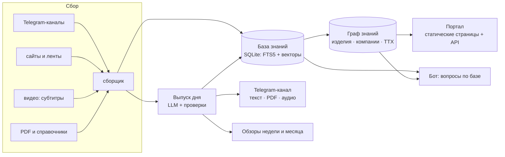

# Аналитика военных технологий по открытым источникам

**Asymmetria** ([asymmetria.tech](https://asymmetria.tech)) — аналитический продукт о военной технике и технологиях: ежедневный выпуск в Telegram, база знаний, граф изделий и производителей, веб-портал с инструментами и бот, отвечающий на вопросы по базе. Всё собирается из открытых источников, и у каждого утверждения — ссылка на первоисточник.

Этот репозиторий — **кейс**: как продукт устроен и как он построен одним человеком вместе с ИИ-агентами за четыре месяца. Рабочий код продукта закрыт; здесь — архитектура, ключевые решения, методы работы и несколько очищенных общих модулей.

**Автор:** Paul Makarevich · [paulmakarevichart@gmail.com](mailto:paulmakarevichart@gmail.com) · Telegram [@Paulmakarevichart](https://t.me/Paulmakarevichart)

---

## Что делает продукт

- **Каждое утро** — выпуск: что нового в беспилотниках, противодействии им, ПВО, РЭБ, связи, военном космосе, ИИ. Из сотен постов за сутки — главное, с проверкой фактов до публикации, PDF с фотографиями техники и аудиоверсией.
- **Раз в неделю и раз в месяц** — обзоры трендов с векторными проекциями: куда пойдёт тренд и по какому признаку это проверить. Месячный выпуск сверяет прошлые прогнозы с тем, что случилось.
- **База знаний** — посты, статьи, справочники и PDF с полнотекстовым и векторным поиском.
- **Граф знаний** — изделия, производители, компоненты, технологии; характеристики с числом независимых источников у каждого значения.
- **Портал** — карточки изделий, карта технологий, кривая зрелости, география производства, открытые отраслевые обзоры с интерактивными 3D-схемами.
- **Бот** — вопросы по базе со ссылками на источники, досье на изделие, оплата подписки.

## Масштаб (ноябрь 2026)

| | |
|---|---|
| Постов из Telegram-каналов в базе | 157 тыс., 124 канала |
| Внешних статей и фрагментов справочников | 18 тыс. |
| Ежедневных выпусков | 149 подряд, с июля 2026 |
| Граф знаний | 10,6 тыс. сущностей · 60,8 тыс. характеристик · 21 тыс. связей |
| Код | ~135 тыс. строк Python · 79 модулей · ~150 тестов · 985 коммитов за 4 месяца |

## Архитектура одним взглядом

Подробно — [docs/architecture.md](docs/architecture.md).

## Стек

Python · Telethon · SQLite (FTS5 + sqlite-vec) · эмбеддинги Voyage · модели Claude (Opus, Sonnet, Haiku, Fable) с резервом Gemini через Google Cloud · WeasyPrint · D3 и three.js · nginx · systemd и cron на виртуальной машине в Google Cloud · Telegram Bot API · синтез речи Google.

## Как это построено

Продукт написан одним человеком вместе с ИИ-агентами (Claude Code). Главное, чему я научился, — не «попросить модель написать код», а **построить систему, в которой агентам можно доверять работу**:

- **Песочница на каждую команду агента** и отдельный пользователь для прода: агент физически не видит ключей и не может выкатить код сам.
- **Выкатка — кнопкой в боте**, через гейты: проверка импорта всех модулей, тест прав доступа, зелёный прогон «лаборатории» для любой правки пути выпуска.
- **Лаборатория выпуска**: полный прогон дня без публикации, со своим суточным потолком трат, — правка проверяется на реальных данных, а не на ощущениях.
- **Журнал уроков**: каждая авария — что сломалось, почему, что из этого следует; правило попадает в код или тест, а не остаётся запиской.
- **Деньги под контролем**: учёт стоимости каждого вызова модели, рубильники по тратам, выбор модели по замеру на своих задачах.
- **Проверка ИИ на архиве**: прогнозы разных моделей строятся задним числом и сверяются слепым судьёй с тем, что произошло.

Подробно — [docs/ai-agents.md](docs/ai-agents.md), решения — [docs/decisions.md](docs/decisions.md), уроки — [docs/lessons.md](docs/lessons.md).

## Что в репозитории

| Папка | Что |
|---|---|
| [docs/](docs/) | архитектура, работа с ИИ-агентами, решения, уроки |
| [examples/](examples/) | очищенные общие модули: темы по векторам, клиент долгого декодирования Gemini, гейт выкатки, проверка прогнозов на архиве |

Промпты, список источников, конвейер графа, данные и устройство сервера сюда не входят — это и есть продукт.

## Права

© 2026 Paul Makarevich. Все права защищены. Код и тексты опубликованы для ознакомления — см. [LICENSE](LICENSE).
