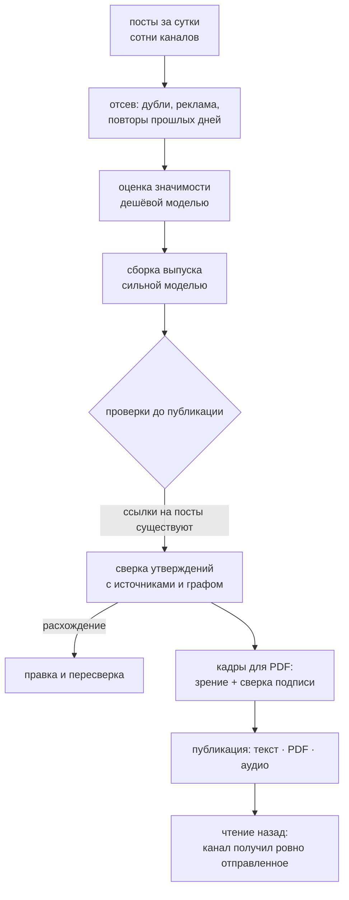

[English](en/architecture.md)

# Архитектура

Продукт — набор прогонов по расписанию и два постоянных сервиса (бот и API портала) на одной виртуальной машине. Данные — в SQLite-базах, страницы портала собираются статикой.

## Суточный цикл

| Время (МСК) | Шаг | Что происходит |
|---|---|---|
| 08:00 | выпуск | сбор постов за сутки → оценка значимости → сборка выпуска моделью → проверки → публикация текста, PDF и аудио |
| 08:40 | база знаний | новые посты, выпуски и PDF режутся на фрагменты, получают векторы |
| 08:50 | граф | разбор постов в сущности, характеристики и связи |
| 10:00 | ленты | внешние сайты и ленты; короткий анонс — скачивается сама статья |
| 11:00 | портал | карточки, инструменты, «Новости», английская версия, карта сайта |
| 21:00 | аннотации | пересчёт описаний изделий, у которых выросло число фактов |
| вс 20:00 | обзор недели | синтез семи выпусков: сдвиги, тренды, слабые сигналы, проекции |
| 1-е число | итоги месяца | темы месяца по векторам, векторы, счёт прогнозов, проекции на 1–6 месяцев |

Каждый прогон начинается с проверки импорта всех модулей и сообщает о себе внешнему сторожу: молчание машины — тоже тревога.

## Выпуск дня

Принципы:

- **Проверка до публикации, а не после.** Ошибка, которую прочитали подписчики, стоит доверия целиком.
- **Подпись под фото — то, что на нём опознано**, а не текст рядом с кадром.
- **Каждая ссылка на пост проверяется** по архиву: модель иногда «вспоминает» несуществующие адреса.
- **Нейтральный язык**: стороны называются прямо, без оценочных слов — это проверяет и промпт, и код.

## База знаний

SQLite: полнотекстовый индекс FTS5 со стеммингом и векторный индекс sqlite-vec (эмбеддинги Voyage, 512 измерений). Поиск гибридный: BM25 + векторная близость. Источники — посты, внешние статьи, справочники и PDF (с распознаванием сканов), сами выпуски.

## Граф знаний

Сущности (изделия, компоненты, технологии, компании, страны, события) и связи («производит», «комплектующее», «чем подавляется», «развито из»). У каждой характеристики — источники и число **независимых** источников: посты одного канала — это один источник, фрагменты одного документа — тоже один. Уровни достоверности: из источника, правка эксперта, выведено моделью — выведенное помечено и за факт не выдаётся.

Чистка графа — отдельная дисциплина: дубли в разных написаниях и на разных языках, куски текста вместо имён, перепутанные направления связей. Её делали волнами ИИ-агентов с проверкой на копии базы и применением после подтверждения.

## Портал

Статические страницы, собранные генераторами на Python: карточка изделия (радиальная схема фактов, таблица с источниками), карта технологий, кривая зрелости, география производства, ось времени, поиск, сравнение. Открытая часть — главная, «Новости», отраслевые обзоры; инструменты — по подписке. Есть английская версия: словарь переводов строк и ежедневный перевод нового.

## Модели

| Задача | Модель |
|---|---|
| сборка выпуска, синтез обзоров | сильная (Opus) |
| оценка значимости, разбор постов в граф, ленты | средняя (Sonnet) |
| ответы бота | лёгкая (Haiku) |
| глубокие проекции, сравнение на архиве | самая сильная (Fable) и Gemini |

Резерв: при отказе основного поставщика конвейер сам переходит на те же модели через Google Cloud, затем на Gemini, и сам возвращается. Каждый вызов записывается в учёт стоимости.
