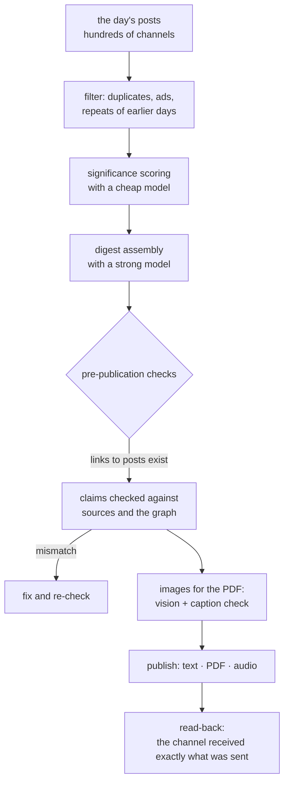

[Русский](../architecture.md)

# Architecture

The product is a set of scheduled runs plus two long-running services (the bot and the portal API) on a single virtual machine. Data lives in SQLite databases; portal pages are generated as static files.

## The daily cycle

| Time (Moscow) | Step | What happens |
|---|---|---|
| 08:00 | digest | collect the day's posts → score significance → assemble the digest with a model → checks → publish text, PDF and audio |
| 08:40 | knowledge base | new posts, digests and PDFs are chunked and embedded |
| 08:50 | graph | posts are parsed into entities, specifications and relations |
| 10:00 | feeds | external sites and feeds; if a feed gives only a teaser, the full article is fetched |
| 11:00 | portal | system cards, tools, "News", the English version, the sitemap |
| 21:00 | annotations | descriptions are recomputed for systems whose fact count has grown |
| Sun 20:00 | weekly review | synthesis of seven digests: shifts, trends, weak signals, projections |
| 1st of month | monthly review | topics of the month from embeddings, vectors, forecast scorecard, projections for 1–6 months |

Each run starts with an import check of all modules and reports to an external watchdog: silence from the machine is also an alarm.

## The daily digest

Principles:

- **Check before publishing, not after.** An error that subscribers have already read costs trust in everything.
- **An image caption names what is recognised in the image**, not the text that happens to sit next to it.
- **Every link to a post is verified** against the archive: a model sometimes "remembers" addresses that do not exist.
- **Neutral language**: the sides are named directly, with no partisan wording — enforced by the prompt and backed by code.

## Knowledge base

SQLite: an FTS5 full-text index with stemming and a sqlite-vec vector index (Voyage embeddings, 512 dimensions). Search is hybrid: BM25 plus vector similarity. Sources are posts, external articles, reference books and PDFs (with OCR for scans), and the digests themselves.

## Knowledge graph

Entities (systems, components, technologies, companies, countries, events) and relations ("manufactures", "component of", "countered by", "derived from"). Every specification carries its sources and the number of **independent** sources: posts from one channel count as one source, fragments of one document count as one. Three levels of confidence: from a source, an expert edit, inferred by a model — inferred values are marked and never presented as facts.

Cleaning the graph is a discipline of its own: duplicates in different spellings and languages, text fragments instead of names, reversed relation directions. It was done in waves of AI agents, tested on a copy of the database and applied only after confirmation.

## Portal

Static pages produced by Python generators: the system card (a radial map of facts, a table with sources), a technology map, a maturity curve, production geography, a timeline, search, comparison. The open part is the home page, "News" and the industry reviews; the tools are for subscribers. There is an English version: a dictionary of translated strings plus daily translation of new content.

## Models

| Task | Model |
|---|---|
| digest assembly, review synthesis | strong (Opus) |
| significance scoring, parsing posts into the graph, feeds | mid-tier (Sonnet) |
| bot answers | light (Haiku) |
| deep projections, archive comparisons | strongest (Fable) and Gemini |

Fallback: if the main provider refuses, the pipeline switches by itself to the same models through another cloud, then to Gemini, and switches back by itself. Every call is recorded in the cost ledger.
